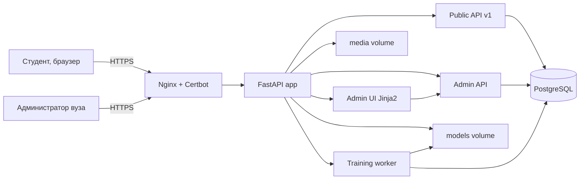
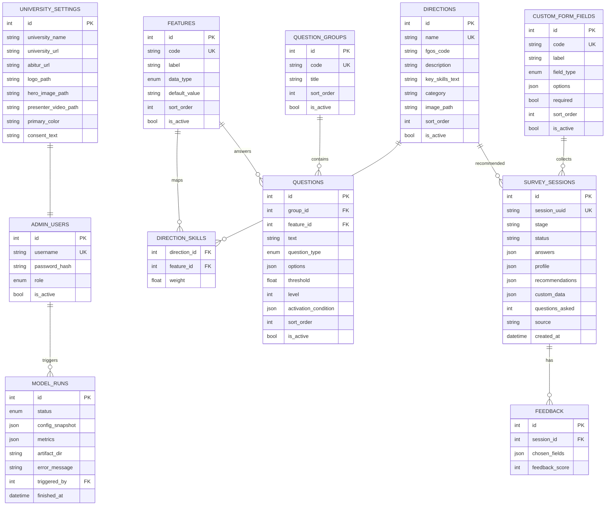
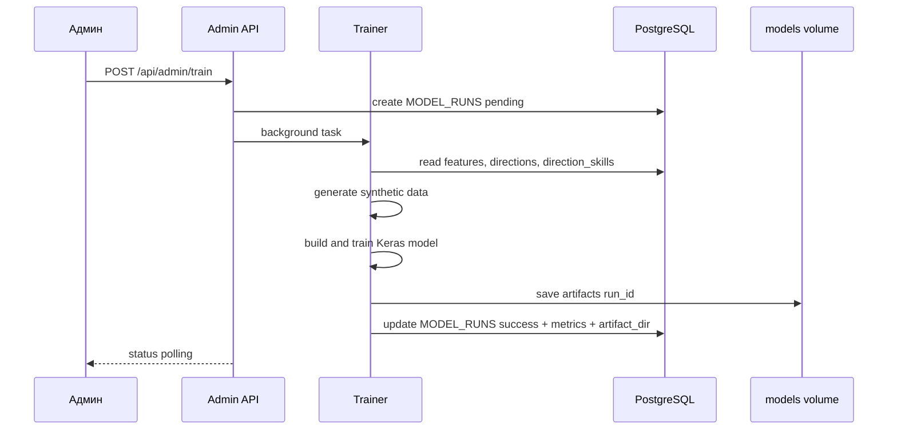

# CareerAI Platform — план развития

## 1. Цель

Превратить одностороннее приложение CareerAI (Университет «Дубна») в **настраиваемую платформу профориентации**, разворачиваемую отдельным инстансом под каждый вуз. Каждый инстанс получает:

- собственную конфигурацию (вуз, логотип, картинки, видео, аудио);
- собственный набор **направлений**, **признаков** и **вопросов** (хранятся в БД, настраиваются через админку);
- собственную **модель** (обучается динамически по конфигурации);
- **анкету сбора данных**, которую вуз настраивает сам;
- **веб-админку** на текущем стеке (FastAPI + Jinja2/JS);
- **HTTPS** через Nginx + Let's Encrypt.

## 2. Принятые архитектурные решения

| Решение | Выбор |
|---|---|
| Мультитенантность | Отдельный инстанс на вуз, конфигурация в БД |
| База данных | PostgreSQL (отдельный контейнер) |
| Админка | Веб-UI в текущем стеке (FastAPI + Jinja2/JS) |
| Модель | Полная гибкость: признаки, направления, вопросы из БД; модель собирается динамически |
| Обучение | Запуск из админки, фоновая задача, версии артефактов |
| Аутентификация | JWT + учётные записи админов в БД (роли admin/viewer) |
| HTTPS | Nginx reverse-proxy + Let's Encrypt (certbot), автообновление |
| Миграции БД | Alembic |

## 3. Целевая архитектура



## 4. Схема данных (PostgreSQL)



Ключевые решения схемы:

- **Признаки** (`features`) — бывшие 27 констант `EXPANDED_FEATURES` становятся строками; `data_type` определяет способ ввода (оценка 1–5, зарплата, число, текст).
- **Связь направление-навыки** — M:N таблица `direction_skills` вместо словаря `DIRECTION_KEY_SKILLS`.
- **Вопросы** — группируются по этапам (`question_groups`: screening/detailed/personal/salary/custom); ветвление адаптивной цепочки описывается через `threshold`, `level` и `activation_condition` (например, «активируется, если interest >= 3»).
- **Сессии опросов** — JSONB-колонки вместо CSV (`answers`, `profile`, `recommendations`, `custom_data`); CSV-экспорт остаётся как функция админки.
- **Версии моделей** — `model_runs` хранит снапшот конфигурации обучения и путь к артефактам, чтобы переобучение не ломало работающую версию.

## 5. API

### Публичный (без аутентификации)

- `POST /api/v1/start` — начало опроса, первый вопрос
- `POST /api/v1/answer` — ответ + следующий вопрос (конечный автомат: screening → detailed → personal → salary → custom)
- `POST /api/v1/survey-data` — сохранение анкеты вуза (кастомные поля + согласие на обработку ПДн)
- `POST /api/v1/feedback` — метки выбранных направлений + оценка
- `GET /api/v1/directions` — активные направления
- `GET /api/v1/settings` — настройки вуза (название, медиа, текст согласия)

### Админ (JWT, роли admin/viewer)

- `POST /api/admin/auth/login`, `POST /logout`, `GET /me`
- CRUD: `directions`, `features`, `questions`, `question-groups`, `custom-fields`, `users`
- `GET/PUT /api/admin/settings`
- `POST /api/admin/media` — загрузка изображений/видео/аудио (multipart, проверка типа и размера)
- `POST /api/admin/train` — запуск переобучения в фоне; `GET /api/admin/train/status`
- `GET /api/admin/stats` — статистика сессий, меток, качества модели
- `GET /api/admin/responses.csv` — экспорт ответов

## 6. Ключевые сервисы (рефакторинг завершён)

Легаси-модули корня удалены при реструктуризации; их функции живут в платформе:

- вопросы опросника → конфигурация [`config/questions.py`](config/questions.py) + динамический движок `app/services/questionnaire.py` (вопросы из БД, пороги цепочек, активация по интересам);
- рекомендации → `app/services/recommender.py`: направления/признаки из БД, артефакты модели по `model_runs`, объяснения;
- обучение → `app/services/trainer.py`: синтетика по правилам из БД, динамическая Keras-модель, артефакты в `models/{run_id}/`, история в `model_runs`;
- веб-опросник → фабрика приложения `app/main.py` + роутеры `app/api/`;
- сбор ответов → `app/services/responses.py` (запись в БД, экспорт CSV);
- **Безопасность** `app/services/security.py`: bcrypt, JWT с TTL, rate-limiting, httpOnly-cookie.

## 7. Админ-интерфейс (страницы /admin/*)

- Дашборд: статистика сессий, статус обучения, метрики последней модели
- Редактор направлений (код ФГОС, описание, навыки, картинка)
- Редактор признаков
- Конструктор вопросов (группы, пороги ветвления, условия активации)
- Конструктор анкеты вуза (кастомные поля, обязательность, согласие на ПДн)
- Медиатека (загрузка/замена логотипа, картинок, видео, аудио)
- Настройки вуза (название, ссылки, цвета, текст согласия)
- Пользователи (CRUD, роли)
- Ответы (просмотр, экспорт CSV)

## 8. Обучение модели в фоне



## 9. Деплой (docker-compose)

```yaml
services:
  nginx:      # reverse-proxy + TLS (certbot), / -> app
  certbot:    # Let's Encrypt, автообновление
  app:        # FastAPI + uvicorn, HOST=0.0.0.0
  db:         # postgres:16, volume pgdata
volumes: pgdata, media, models, certbot-conf, certbot-www
```

- Настройки подключения, домен, секреты — через env (`.env`, не в git).
- При старте: миграции Alembic + полный сид (базовые 21 направление / 32 признака + блок ЕГЭ + 31 активная программа).
- Внутри сети — HTTP, TLS терминирует nginx.

## 10. Этапы реализации

1. **Каркас**: пакет `app/`, pydantic-settings, SQLAlchemy, Alembic, PostgreSQL в compose
2. **Схема и сид**: модели ORM + seed из текущего конфига (направления, признаки, вопросы)
3. **Публичный API v1**: движок опросника из БД, рекомендатель, сессии в БД, анкета вуза
4. **Сервис обучения**: динамический тренировщик, фоновые задачи, версии моделей
5. **Безопасность**: JWT, пользователи, роли, rate-limiting
6. **Админ API**: CRUD каталога, вопросов, анкеты, медиа, настроек
7. **Админ UI**: страницы на Jinja2 + JS
8. **Миграция данных**: перенос `data/real/responses.csv` в БД (одноразовый скрипт)
9. **Деплой**: nginx + certbot, обновление Dockerfile/compose, env-секреты
10. **Тесты и документация**: юнит- и интеграционные тесты, обновление README

## 11. Обратная совместимость

- CLI доступен через `python -m app.cli recommend <csv>` и `python -m app.cli ask`; консольный опросник — `python -m config.questions` (конфигурация из БД).
- Каталог конфигурируется через БД и админку; правки вносятся там, а не в код.
- Синтетические правила обучения воспроизводятся генератором на данных из БД.